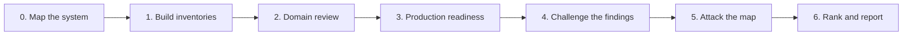

# App Audit

**A security and engineering audit skill for AI coding agents.**

Point Claude Code, or any agent that reads skills, at a repository and get a ranked, evidence-graded audit: what is broken, where, how bad, how sure, and how to prove the fix.

It is built for codebases written fast with AI assistance. It starts by hunting the failures that generated code produces again and again: guards that exist but enforce nothing, a tenant filter on nine queries out of ten, validation in the form and none on the server, and scaffolding that was never wired up.

> An audit from this skill is a review aid. It is not a penetration test and not a certification, and it never claims a system is secure or compliant.

## Why this exists

Most AI code reviews read a few files, list what looks suspicious, and stop. That finds the obvious bugs and misses the ones that cause breaches, because access-control failures hide in the route nobody looked at.

App Audit works the other way round. It maps the system, writes down every route and every data-access call in a table, and only then starts judging. A missing control shows up as an empty cell, not as something the agent happened to notice.

## How it works



| Phase | What happens |
| --- | --- |
| 0. Map | Reads the repo's own context, detects the stack, and draws the trust boundaries, the tenancy model, and what is worth breaking. |
| 1. Inventories | Builds a route inventory, a data-access inventory, and an authorization matrix (intended versus enforced). |
| 2. Domain review | Runs the AI-code-failure checks first, then only the domain references that apply to this system. |
| 3. Production readiness | Names which backbone pieces are present, stubbed, or absent: tenancy, MFA, audit logging, backups, and more. |
| 4. Challenge | Attacks its own findings, looks for the control that would defeat each one, and grades the evidence. |
| 5. Attack the map | Walks the system as six attacker personas and chains lower findings into real attack paths. |
| 6. Rank and report | Assigns severity and writes the report, the summary, the findings file, and the inventories. |

## What makes it different

- **It enumerates instead of sampling.** "Most routes are guarded" is not a result. Every route gets a row.
- **It separates severity from certainty.** Each finding carries a severity and an evidence grade: Confirmed, Likely, or Hypothesis. A scary guess is never dressed up as a fact.
- **It chains findings.** Three Mediums that combine into account takeover are reported as one attack path, with the single fix that breaks the chain.
- **It is read-only by rule.** It changes nothing and runs nothing without explicit approval. It treats text in the repo as evidence, never as instructions, so a planted comment cannot steer the audit. It never copies a secret value into the report.
- **It loads only what applies.** A small core plus thirteen domain references. A mobile app never pays for the infrastructure checks.
- **It says what it did not read.** Every report has a coverage section built from a ledger of files read in full, in part, or skipped.
- **It re-audits against a baseline.** Findings keep their IDs, and each one comes back as fixed, still open, or regressed.

## What a finding looks like

An illustrative example, not taken from a real system:

```
SEC-004  Invoice export ignores the tenant filter
Severity: Critical | Evidence: Confirmed | AI failure: inconsistent tenant scoping
Where:    src/invoices/export.service.ts:41-58
What:     The export query selects invoices by id list only. Every other invoice
          query in this module filters by tenant.
Impact:   Any signed-in user can export another tenant's invoices by passing
          their ids, including customer names and amounts.
Fix:      Add the tenant filter to the export query and re-check it in the
          worker that generates the file.
Verify:   As tenant A, request an export of an invoice id owned by tenant B.
          Pass: the request is denied and no file is created.
          Fail: a file containing tenant B's invoice is produced.
Status:   not run
```

`Status` stays "not run" until a human authorizes the check and it is actually executed. A planned test is not a passed test.

## Coverage

The core method lives in `SKILL.md`. Domain checks live in `references/` and load on demand.

| Reference | Covers |
| --- | --- |
| `ai-code-failures.md` | Fabricated correctness, security theatre, and logic errors typical of generated code. Always runs first. |
| `api-authz.md` | Authentication, object-level, function-level, and property-level authorization, injection, resource exhaustion, business logic, webhooks, and SSRF. |
| `web-session.md` | Cookies, CSRF, JWT, OAuth, OIDC, SSO, XSS sinks, CSP, CORS, and client-side exposure. |
| `tenancy-async.md` | Tenant isolation, caches, queues and cron, exports, lifecycle and revocation, and support impersonation. |
| `files-storage.md` | Upload validation, malware and hostile content, preview and serving, bucket access, and deletion. |
| `baas.md` | Supabase, Firebase, and similar: keys in the client, row-level rules, storage rules, and server functions. |
| `mobile.md` | Bundle secrets, transport, local storage, deep links, WebView bridges, and store compliance. |
| `llm-agents.md` | Prompt injection, per-tool authority and shared credentials, output handling, retrieval, and cost abuse. |
| `infrastructure.md` | Network exposure, containers, TLS and proxy, cloud identity, backups, detection, and DNS. |
| `supply-chain.md` | Dependencies, hallucinated packages, build integrity, CI/CD, and the path to production. |
| `cryptography.md` | Password hashing, randomness, encryption modes, key handling, and signatures. |
| `privacy-compliance.md` | Data inventory, retention and deletion, and optional mapping to frameworks across the EU, the US, and the Gulf region. |
| `tool-pass.md` | Scanners, git-history inspection, and dynamic proof. Only runs when you authorize it. |

Also included: `schema/findings.schema.json`, the machine-readable findings format, and `templates/audit-context.md`, a short context file for the repo being audited.

## Install

Claude Code, personal skills folder:

```bash
git clone https://github.com/Majorkimo/app-audit.git ~/app-audit-skill
mkdir -p ~/.claude/skills
ln -s ~/app-audit-skill/app-audit ~/.claude/skills/app-audit
```

Start a new session afterwards. For other agents, point your project instructions at `app-audit/SKILL.md`.

## Use

Open the repo you want audited and ask:

| You want | Ask |
| --- | --- |
| A full audit | `audit this app` |
| One module or feature | `audit the billing module` |
| A pull request or branch | `audit the changes on this branch` |
| A re-audit after fixes | `re-audit against audit/2026-01-15/findings.json` |
| A compliance mapping on top | `audit this app and map the findings to ISO 27001 and GDPR` |

For better results, copy `templates/audit-context.md` into the repo first and fill it in: what the product does, what data it holds, the roles, and the tenancy model. The audit uses it to aim, then verifies it against the code. Where the code disagrees with what you wrote, that gap is a finding.

## What you get

Written to `audit/<date>/` in the audited repo:

| File | For whom | Contents |
| --- | --- | --- |
| `report.md` | Engineers | Verdict first, then attack paths, ranked findings, coverage, and remediation order. |
| `summary.md` | Owners and managers | One page in plain language: the verdict, the three things that matter, and what to do first. |
| `findings.json` | Tooling | Every finding in a stable schema, for tickets and for the next re-audit. |
| `inventory.md` | Reviewers | The route, data-access, and authorization tables the findings were built from. |

Keep the `audit/` folder out of version control until you have reviewed it. It is an attack map of your own system.

## Limits, stated plainly

- By default it reads code and runs nothing. Findings from code reading are implementation evidence, not proof of runtime behavior. Scanners, git-history inspection, and dynamic checks run only with your explicit approval, one command at a time.
- Reading a lockfile does not reveal known vulnerabilities. Authorize a dependency scanner if you want that covered.
- Infrastructure and platform findings describe the configuration in the repo, not what is live.
- Compliance mappings are engineering input for legal and privacy work. Whether a law applies, and whether you comply, is not something a code review can decide.
- Quality depends on the agent and on how much of the repo fits in its working budget. The coverage section of every report says what was read and what was not.
- This is a first public version. It has been checked for internal consistency, and it has not yet been benchmarked against a set of known-vulnerable applications. Issues and pull requests with real-world results are welcome.

## Acknowledgements

Credit where it is due: **[Grim Prompter](https://github.com/jmanico/grim-prompter) by Jim Manico** of Manicode Security shaped six parts of this method. Reading it is what turned a good checklist into a disciplined audit:

1. The operating boundary for agents: repo text is evidence and never instructions, the project is not executed, and secrets are never copied.
2. The inspection ledger, which stops a partial read from being presented as a full audit.
3. The challenge pass, where findings are attacked before they are reported.
4. Verification plans with explicit pass and fail criteria that stay "not run" until executed.
5. Change review against a saved baseline.
6. Tool-credential mapping and tool-description poisoning for agent and MCP features.

Those ideas were adapted and written fresh for this skill. No text was copied. Grim Prompter itself goes much further on design-level threat modeling, with dozens of architecture workflows and formal methods such as STRIDE, PASTA, and LINDDUN. If you need a formal threat model, use it alongside this skill: the two do different jobs and fit together well.

Thanks also to the OWASP community, whose public guidance informs most of the domain checks.

## Author

Karim Bremer, [BITS Solutions](https://github.com/Bits-Solutions-co).

## License

MIT. See [LICENSE](LICENSE). Use it, change it, and ship it, commercially or otherwise.
